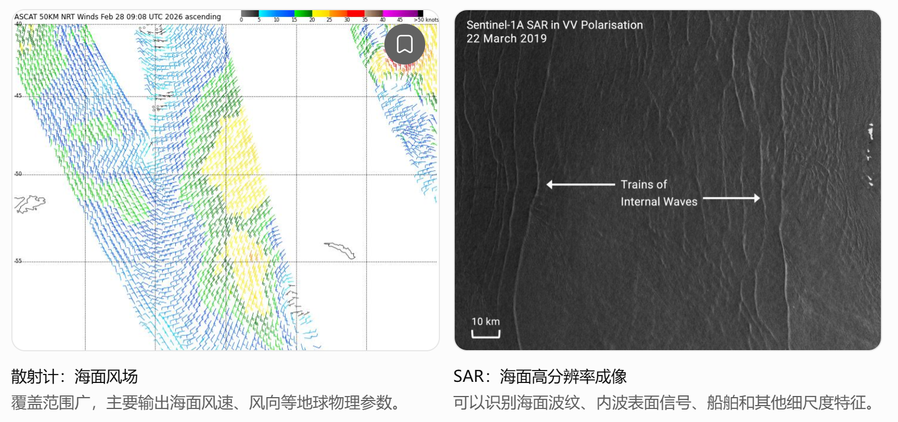
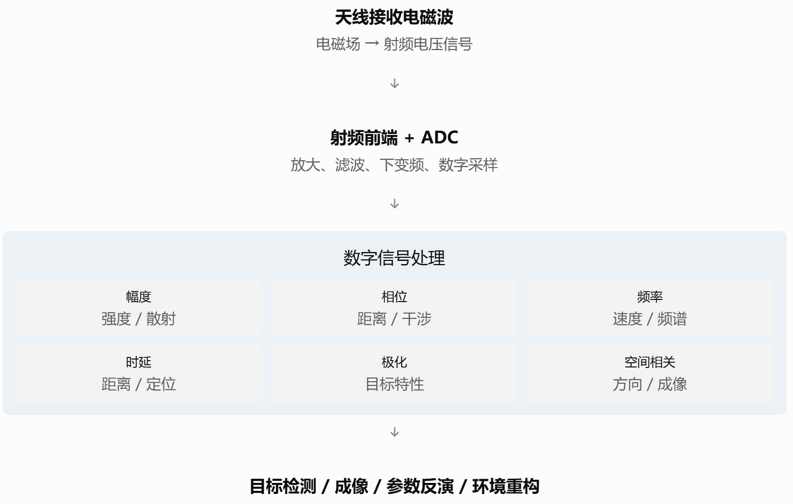
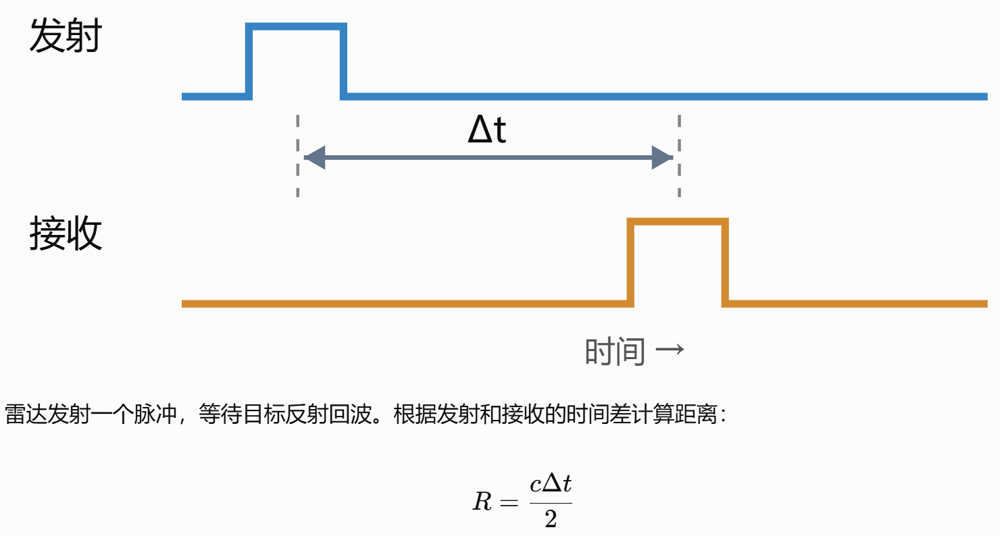
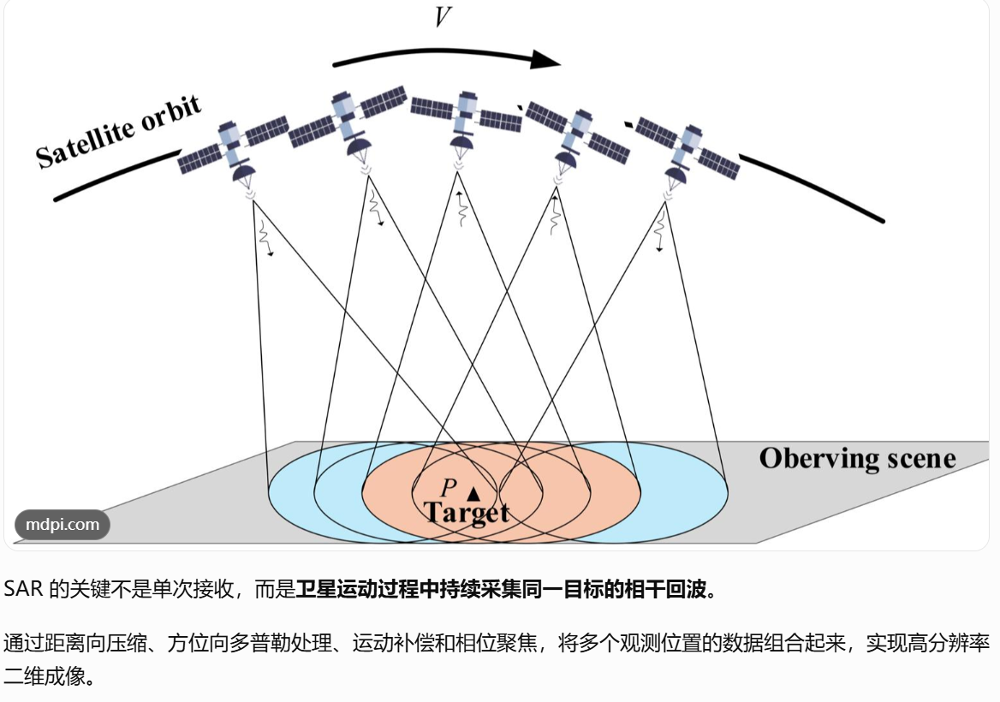
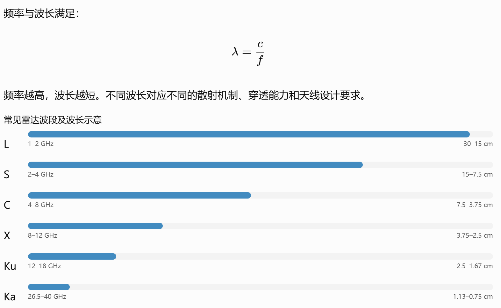
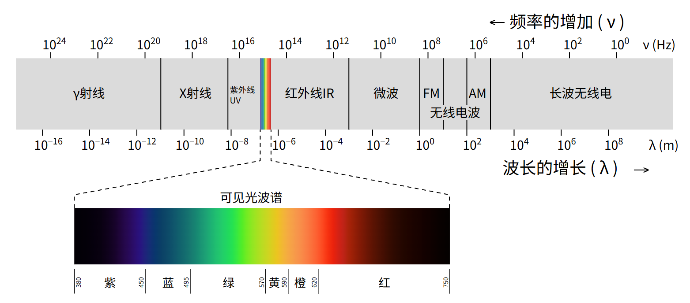
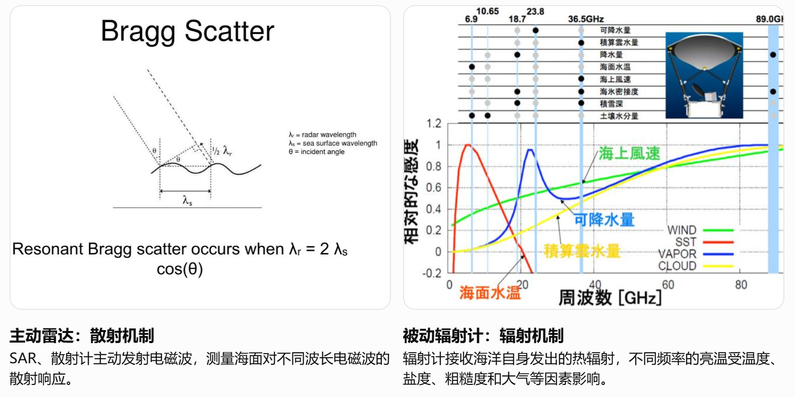

### 通信卫星和遥感卫星的差异

通信卫星（“传话筒”）

- **工作原理**：地面站把电视、电话或网络数据发射到卫星上，卫星上的**通信转发器**收到信号后进行放大和处理，再转发到另一个地面接收站。接收的是地面通信设备或其他卫星**发射的携带数字信息的电磁波**，再进行转发处理。
- **覆盖特点**：一颗静止轨道的通信卫星可以覆盖地球表面的很大面积（约占40%左右）。
- **代表任务**：转播世界杯赛事、远洋航海通信、偏远地区宽带上网。 

遥感卫星（“侦察兵”）

- **工作原理**：通过主动或被动的方式，接收物体发射或反射的**电磁波**，从而“看清”地面的地形、气象或环境。
- **覆盖特点**：为了拍得更清晰、看得更精细，通常运行在较低的轨道上（离地面较近）。
- **代表任务**：天气预报云图拍摄（如中国的“风云”系列）、城市规划监测、灾害（如洪水、森林火灾）评估。

### 微波散射计和SAR的差异

散射计和 SAR本质上都是主动微波雷达遥感载荷。 两者都会通过天线向海面发射电磁波，再接收海面散射回来的信号。

**核心区别**：

* 散射计：重点测量海面的后向散射强度，用于反演海面风场。
* SAR：重点利用回波的幅度、相位及卫星运动形成高分辨率雷达图像，用于识别海面精细结构和目标。

**关键技术指标**

| 对比项目   | 微波散射计                                   | SAR                                        |
| ---------- | -------------------------------------------- | ------------------------------------------ |
| 工作原理   | 主动微波散射测量                             | 主动微波相干成像                           |
| 典型频段   | C、Ku 波段                                   | L、C、X 等波段                             |
| 主要测量量 | 归一化雷达后向散射系数 σ⁰                    | 复数雷达回波及其成像结果                   |
| 空间分辨率 | 通常约 10–50 km                              | 通常米级至数十米级                         |
| 观测幅宽   | 数百至上千公里                               | 数十至数百公里，部分模式更宽               |
| 海面风场   | 核心应用，可反演风速和风向                   | 可以反演高分辨率风速，风向通常需要外部信息 |
| 海浪       | 可提供一定海况信息，通常不是直接测量完整波谱 | 可分析部分波浪谱和波纹结构                 |
| 海洋内波   | 难以直接识别细尺度内波结构                   | 可观测内波引起的海面粗糙度调制             |
| 船舶识别   | 通常不适合                                   | 具有明显优势                               |
| 数据处理   | 相对简单                                     | 相干聚焦与成像处理更复杂                   |
| 载荷成本   | 不一定低，取决于具体架构                     | 高分辨率 SAR 通常更复杂、成本更高          |

**雷达信号处理方式**

散射计通常通过多个观测方向测量同一海域的后向散射系数：$ \sigma^0=f(U_{10},\phi,\theta,\mathrm{pol},\ldots) $。通过地球物理模型函数（GMF）反演风速和风向。

SAR 则利用卫星沿轨道运动过程中，在不同位置接收到的相干回波，通过相位补偿和合成孔径聚焦，获得远高于真实天线方位向波束宽度所对应的空间分辨率。

### 雷达信号处理

SAR、散射计、雷达高度计、多普勒雷达、相控阵雷达乃至无源 RF 监测系统，很多时候使用的是相似的射频硬件，真正的区别在于发射什么信号、接收什么信号、采用什么处理算法，以及最终希望得到什么物理量。

**通过分析电磁波的幅度、相位、频率、时间延迟、极化及其变化，提取目标或环境的信息。**

六种重要的信号信息

| 信息        | 物理意义                         | 典型用途                     |
| ----------- | -------------------------------- | ---------------------------- |
| 幅度 / 功率 | 接收信号有多强                   | 散射强度、目标检测           |
| 相位        | 波在传播过程中积累的相位         | 干涉测量、SAR 聚焦、微小位移 |
| 时延        | 信号往返传播所需时间             | 测距、高度计                 |
| 多普勒频移  | 目标相对运动导致频率变化         | 测速、SAR 成像               |
| 极化        | 电场振动方向及其变化             | 目标分类、海冰识别           |
| 空间相关性  | 不同天线接收信号的相位和幅度关系 | 波束形成、测向、干涉成像     |

例如，通过时间延迟测量距离  

利用相位历史进行合成孔径成像（SAR）  

| 观测信息         | 可以约束的物理量     | 物理 AI 的潜在用途     |
| ---------------- | -------------------- | ---------------------- |
| 回波强度         | 海面粗糙度、散射特征 | 海风、海浪相关参数反演 |
| 相位差           | 距离变化、形变、运动 | 干涉测量与运动估计     |
| 多普勒频移       | 径向速度             | 海流及运动目标状态估计 |
| 极化特征         | 目标散射机制         | 海冰、目标类型识别     |
| 射频功率谱       | 辐射源频率与功率分布 | 电磁环境频谱重构       |
| 多天线空间相位差 | 信号到达方向         | 辐射源定位与空间场估计 |

### 不同波段

**电磁波的频率和波长不同，进而导致它们与海面、目标、大气发生相互作用的方式不同。** 因此，C 波段 SAR 和 X 波段 SAR 即使采用相同的成像算法，**得到的散射特征也可能不同。**  

不同波段对海洋遥感意味着什么？

| 波段 | 海洋遥感特点                                                 | 典型应用                                |
| ---- | ------------------------------------------------------------ | --------------------------------------- |
| L    | 波长较长，对较长尺度的海面粗糙度敏感；受雨衰影响较小         | 海面盐度辐射测量、海流相关雷达研究、SAR |
| C    | 对厘米级海面粗糙度敏感，风场反演成熟                         | SAR、海面风场散射计                     |
| X    | 对更短的海面波纹敏感，能够呈现精细的海面散射变化             | 高分辨率 SAR、船舶与内波表面特征        |
| Ku   | 对短波粗糙度敏感，风场测量能力成熟，但降雨影响更明显         | 海面风场散射计、雷达高度计              |
| Ka   | 波长更短，可使用较小天线形成较窄波束，但更容易受到大气衰减影响 | 高精度高度计、宽刈幅干涉高度计          |

不同频率的电磁波与海洋、大气和目标物体相互作用的方式不同。不同波段对不同物理变量的敏感程度不同，因此需要根据希望观测的变量来选择波段。

#### 机制一：波长决定对哪种尺度的海面波纹更敏感

海面不是完全平滑的，存在从毫米到数百米甚至更长尺度的波浪。

雷达的后向散射通常受到布拉格散射机制影响：$ \lambda_{\mathrm{sea}}=\frac{\lambda_{\mathrm{radar}}}{2\sin\theta} $

假设入射角为 35°：

| 雷达波段 | 代表频率 | 雷达波长 | 对应布拉格海面波长 |
| -------- | -------- | -------- | ------------------ |
| L        | 1.3 GHz  | 23.1 cm  | 20.1 cm            |
| S        | 3.2 GHz  | 9.4 cm   | 8.2 cm             |
| C        | 5.4 GHz  | 5.6 cm   | 4.8 cm             |
| X        | 9.6 GHz  | 3.1 cm   | 2.7 cm             |
| Ku       | 13.5 GHz | 2.2 cm   | 1.9 cm             |

上述数值为近似计算，适用于理解常见倾斜入射、以布拉格散射为主的情形。真实海面还存在非布拉格散射、破碎波和泡沫等影响。因此：

- C 波段散射计对几厘米尺度的海面短波敏感，这些短波受到局地风的显著影响，因此适合反演海面风场。
- X 波段 SAR 对更短的海面波纹敏感，可用于分析海面精细散射结构。
- L、S 波段对相对较长的海面波纹敏感，具有不同的海况响应。

但并不是波长越短，观测就越好。因为降雨、大气衰减、海面泡沫和信噪比等因素也会影响结果。

#### 机制二：不同频率对温度、盐度的敏感程度不同

对于被动微波辐射计，海水的介电常数与频率、温度、盐度有关，进而影响海面的微波发射率。

在简化的瑞利–金斯近似下：$ T_B(f)\approx e(f,T,S,\theta,\mathrm{pol})\,T $

其中 $$T_B$$是亮温，$$e$$是发射率，$$T$$是海表温度，$$S$$是盐度。

| 目标变量     | 常用观测频率         | 原因                                   |
| ------------ | -------------------- | -------------------------------------- |
| 海表盐度 SSS | 约 1.4 GHz（L 波段） | 海水微波发射率对盐度具有可利用的敏感性 |
| 海表温度 SST | 约 6.9、10.7 GHz 等  | 对海温具有较好的敏感性，需校正其他因素 |
| 海面风速     | 约 5–14 GHz 等       | 海面粗糙度和泡沫改变微波发射率         |
| 大气水汽     | 约 22 GHz 附近       | 水汽具有特征吸收谱线                   |
| 云液态水     | 约 31 GHz 等         | 云液态水对微波辐射产生显著影响         |

这里也能看出：不是每个波段只能观测一种变量，而是某些波段对特定变量更敏感。

## 参考文献

1. https://www.cnsa.gov.cn/n6758968/n6758973/c10583400/content.html
2. https://www.csgpc.org/detail/27648.html
3. https://www.esa.int/Applications/Observing_the_Earth/Meteorological_missions/MetOp/Measuring_wind_over_the_oceans_with_ASCAT
4. https://www.mdpi.com/2072-4292/18/10/1514
