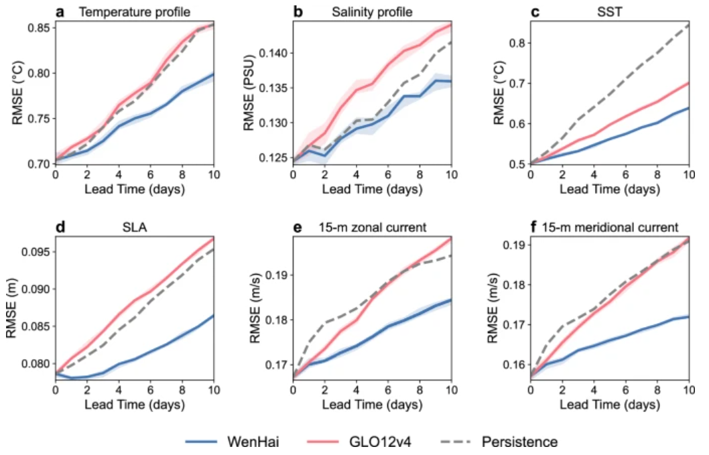
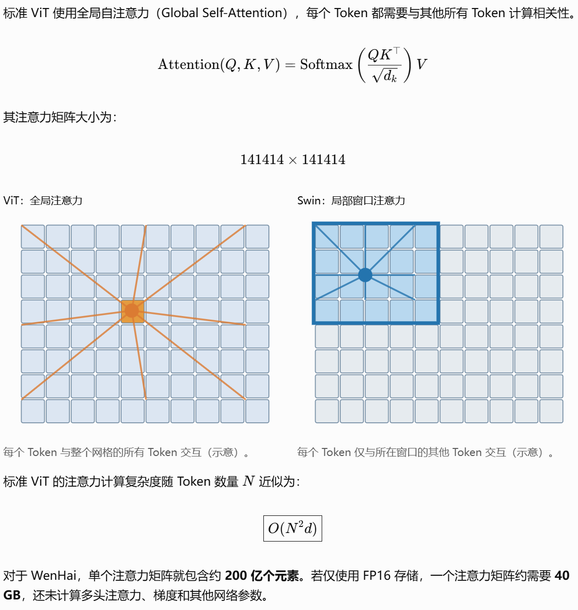
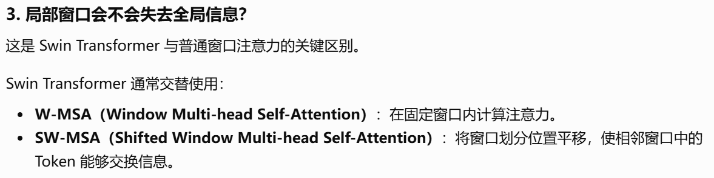
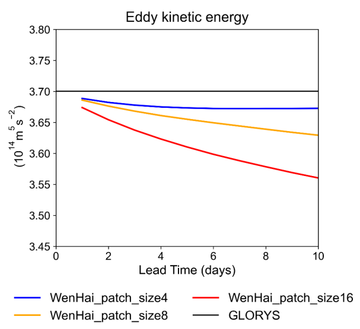

## 问海：涡旋分辨率全球海洋预报

> Cui, Y., Wu, R., Zhang, X. *et al.* Forecasting the eddying ocean with a deep neural network. *Nat Commun* **16**, 2268 (2025). https://doi.org/10.1038/s41467-025-57389-2

### 问海量化指标

* 研究区域：全球上层海洋（0-643m），水平分辨率1/12°，时间分辨率daily
* 预测10天的RMSE  
  

### 模型结构

Swin Transformer

#### 数据流

```
- 输入海洋 O(k)：93x2041x4320
           = [u(23层), v(23层), T(23层), S(23层), SSH(1层)]
- 输入大气 A(k)： u10, v10, msl, t2m, d2m
     ↓ 大气变量插值到海洋网格
     ↓ Bulk Formulae（结合海表状态）
  海气通量 F(k)：8x2041×4320
              = [潜热、感热、净长波、τx、τy、蒸发率、净短波、降水率]
  	  preprocess		
  		↓ zero padding (93或8, 2072,4368)，保证能被7和4整除，海洋和大气分别处理
  		↓ patch embedding (H, 2072/4, 4368/4)，H=768为隐藏层
  		↓ down-sampling (H,518/2,1092/2)
  		↓ permute (259,546,H)
  	  model
  		↓ reshape (141414,H)，即有141414 Tokens，d=H=768
  		↓ add 海洋和大气相加，(141414,H)
  		↓ 10个相同的Swin-Transformer，window size=7
  	  postprocess	
  		↓ up-sampling (H,518,1092)
        ↓ permute (518,1092,H)
        ↓ linear layer (518,1092,1488),1488=93x4x4
        ↓ rearrange (93,2072,4368)
        ↓ pack-back (93,2041,4320)   
- 输出ΔO 
     ↓
    O(t+1) = O(t) + ΔO(t)
```

#### 模型选择Swin Transformer而不是ViT

  

   

  文中曾提到，采用更大的 Patch Size 虽然可以进一步降低输入数据的维度，但也可能使模型更难保留海洋中尺度变化特征。如图S15所示，patch size越大，涡动动能EKE衰减更明显。


### 训练策略

* pre-train：预测1天（步） 

  $$ \mathcal L_{\mathrm{1step}} = \sum_i \left\| \mathbf w(i)\odot \left( \Delta\hat{\mathbf O}_{t,i}^{1} - \Delta\mathbf O_{t,i}^{1} \right) \right\|_1 \delta V(i) $$， 其中V是grid体积，w是不同变量的系数，根据归一化后各变量 tendency 的方差进行选择，使不同变量的变化量具有相近的误差贡献。  
  $$  \mathbf w(i)=\frac{\mathbf s}{\delta h(i)} $$，其中δh对应网格层厚。除盐度外，其余归一化海洋变量的 tendency 方差处于相近量级，而归一化盐度 tendency 的方差明显小于其他变量。因此，将**盐度**对应的权重设为 **4.5**，其他变量的权重均设为 1。

* fine-tune：5天自回归，连续滚动预测多天，累计各预测步的误差，优化长期预测稳定性。  
  5天是测试得到的

* 分布式训练：在5 天自回归微调（AR Finetuning）使用分布式训练方法

  ```python
  import torch
  import torch.nn as nn
  import torch.nn.functional as F
  
  class DistributedWenHai(nn.Module):
      def __init__(self, patch_embed, downsample,
                   transformer_blocks, upsample, recovery):
          super().__init__()
  
          assert len(transformer_blocks) == 10
  
          self.stage0 = nn.Sequential(
              patch_embed, downsample,
              transformer_blocks[0]
          ).to("cuda:0")
  
          self.stage1 = nn.Sequential(
              *transformer_blocks[1:4]
          ).to("cuda:1")
  
          self.stage2 = nn.Sequential(
              *transformer_blocks[4:7]
          ).to("cuda:2")
  
          self.stage3 = nn.Sequential(
              *transformer_blocks[7:10]
          ).to("cuda:3")
  
          self.stage4 = nn.Sequential(
              upsample, recovery
          ).to("cuda:4")
  
      def forward(self, ocean, flux):
          # 示意：实际的海洋与通量输入需分别进行 patch embedding，再融合
          x = self.stage0((ocean, flux))
          x = self.stage1(x.to("cuda:1"))
          x = self.stage2(x.to("cuda:2"))
          x = self.stage3(x.to("cuda:3"))
          x = self.stage4(x.to("cuda:4"))
  
          return x  # 预测的海洋状态变化量
      
  model = DistributedWenHai(
      patch_embed, downsample,
      transformer_blocks, upsample, recovery
  )
  
  optimizer = torch.optim.AdamW(model.parameters(), lr=1e-5)
  
  def train_step(ocean0, atmos_seq, truth_seq):
      optimizer.zero_grad(set_to_none=True)
  
      ocean = ocean0.to("cuda:0") #此处不能detach，否则会截断不同预测日之间的梯度传播
      total_loss = 0.0
  
      for day in range(5):
          # 使用当前海洋状态与大气条件计算海气通量
          flux = compute_bulk_flux(
              ocean, atmos_seq[day]
          )
  
          # 完整网络：GPU0 → GPU1 → GPU2 → GPU3 → GPU4
          tendency = model(ocean, flux)
  
          # 预测下一天海洋状态
          next_ocean = ocean.to("cuda:4") + tendency
  
          # 对应的 GLORYS 真实变化量
          target_tendency = (
              truth_seq[day + 1] - truth_seq[day]
          ).to("cuda:4")
  
          loss = weighted_mae(tendency, target_tendency)
          total_loss = total_loss + loss
  
          # 预测结果返回 GPU0，作为下一天输入
          ocean = next_ocean.to("cuda:0")
  
      # 5 天的计算图共同反向传播
      total_loss.backward()
      optimizer.step()
  
      return total_loss.item() 
  ```

### 评估方法

论文提到了 neighborhood-based verification metric ，旨在解决高分辨率海洋预报中传统逐点 RMSE 存在的 双重惩罚问题（Double-penalty Problem）。当模型正确预测了涡旋、锋面等中尺度结构，但其空间位置存在一定偏移时，逐点 RMSE 会同时惩罚真实位置的漏报和预测位置的误报，从而高估预测误差。


